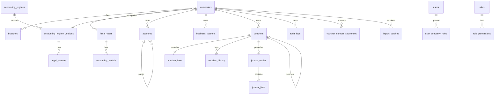

# 02 — Solution Architecture & Database ERD (v0.1)

## 1. Quyết định kiến trúc chính (ADR tóm tắt)

| ADR | Quyết định | Lý do | Phương án loại |
|-----|-----------|-------|----------------|
| ADR-01 | **Một backend .NET 10 duy nhất** (`Hak.Api`) dùng cho cả chế độ một máy và LAN | Một nguồn logic nghiệp vụ, một bộ test | Logic trong Rust/Tauri: trùng lặp nghiệp vụ |
| ADR-02 | **Tauri sidecar**: Tauri khởi chạy `Hak.Api.exe` (self-contained, single-file, win-x64) như sidecar; API chỉ bind `127.0.0.1:<cổng ngẫu nhiên>`; mỗi lần khởi chạy sinh token 256-bit truyền qua stdin; frontend lấy cổng+token qua Tauri command (IPC), không lộ qua URL | Offline, không cần cài .NET runtime, cô lập mạng | WebView gọi thẳng .NET qua COM: phức tạp, khó test |
| ADR-03 | **Chế độ LAN**: cùng `Hak.Api` chạy dạng Windows Service trên máy chủ, provider PostgreSQL, HTTPS (chứng chỉ nội bộ), xác thực người dùng; client Tauri trỏ tới URL máy chủ thay vì sidecar | Ghi trực tiếp qua API, không dùng file JSON làm cơ chế đồng thời (mục 29) | Chia sẻ file SQLite qua SMB: hỏng DB khi khóa mạng |
| ADR-04 | **Provider DB tách migration**: `Hak.Data.Sqlite` và `Hak.Data.Postgres` có thư mục migration riêng từ cùng model | Hai DB khác nhau về decimal, khóa, trigger (mục 26) | Một bộ migration chung: sai kiểu |
| ADR-05 | **Tiền tệ**: C# `decimal`; SQLite lưu `INTEGER` = giá trị × 10⁴ (ValueConverter), PostgreSQL `numeric(19,4)`. Tỷ giá: SQLite `TEXT` invariant, PG `numeric(18,6)` | SQLite không có kiểu decimal, EF lưu TEXT làm SUM/ORDER sai | REAL/DOUBLE: cấm theo 4.3 |
| ADR-06 | **Concurrency**: cột `row_version` (long) tăng trong app, là concurrency token; xung đột → HTTP 409 | SQLite không có rowversion | Last-write-wins |
| ADR-07 | **Bất biến sổ cái 2 lớp**: (a) EF SaveChanges interceptor chặn Update/Delete `journal_*` và chứng từ Posted; (b) trigger DB `RAISE(ABORT)` trên `journal_entries`, `journal_lines` | Bảo vệ cả khi ai đó ghi SQL trực tiếp qua app | Chỉ kiểm tra ở UI |
| ADR-08 | **Audit log chuỗi băm** SHA-256 theo công ty (`prev_hash`, `hash`) + kiểm tra chuỗi | Phát hiện sửa/xóa log (mục 43) | Chữ ký từng dòng bằng khóa: GĐ7 xem xét bổ sung |
| ADR-09 | **JSON gói trao đổi**: canonical = RFC 8785 (JCS); checksum SHA-256; xác thực nguồn = HMAC-SHA256 (khóa chia sẻ theo đối tác) ở v1, Ed25519 ở v2 | Checksum không phải xác thực (mục 27) | Băm chuỗi JSON nguyên văn: phụ thuộc thứ tự khóa |
| ADR-10 | Updater: gói cài MSI offline có chữ ký; Tauri updater chỉ bật khi có máy chủ cập nhật nội bộ | Không phụ thuộc Internet | Auto-update cloud bắt buộc |

## 2. Sơ đồ thành phần

```
┌──────────────────────── Máy trạm Windows ─────────────────────────┐
│  Tauri shell (Rust)  ──IPC(cổng, token)──►  React + TypeScript UI  │
│        │ spawn sidecar                            │ HTTPS/HTTP+Bearer│
│        ▼                                          ▼                 │
│  Hak.Api.exe (127.0.0.1)  ◄───────────────────────┘                 │
│        │  Hak.Application (Posting, RBAC, Audit, Exchange, Reports) │
│        │  Hak.Domain (Money, Voucher, rules — không phụ thuộc I/O)  │
│        ▼  Hak.Data (EF Core) ── SQLite file (WAL)                   │
└────────────────────────────────────────────────────────────────────┘
          Chế độ LAN: UI ──HTTPS──► Hak.Api (Windows Service) ──► PostgreSQL
```

Phân lớp mã nguồn (đã tạo trong `src/`):

| Project | Trách nhiệm | Phụ thuộc |
|---------|-------------|-----------|
| `Hak.Domain` | Thực thể, enum trạng thái, `Money`/làm tròn, validation thuần, lỗi nghiệp vụ | — |
| `Hak.Data` | `HakDbContext`, cấu hình bảng, converter tiền tệ, interceptor bất biến, migration SQLite | Domain, EF Core |
| `Hak.Application` | Accounting Engine, RBAC, audit hash chain, đánh số, khóa kỳ, JSON exchange | Domain, Data |
| `Hak.Api` | ASP.NET Core minimal API, xác thực phiên, ánh xạ lỗi | Application |
| `tests/*` | Unit (Domain), Integration (Application + SQLite file tạm) | |

## 3. Môi trường

`HAK_ENVIRONMENT` ∈ {Development, Test, Production}. Đường dẫn DB mặc định chứa tên môi trường (`%LOCALAPPDATA%\HAK\{env}\hak.db`). Test fixture từ chối chạy nếu chuỗi kết nối không nằm trong thư mục tạm của test (`TestDbGuard`).

## 4. ERD (nhóm lõi đã hiện thực ở GĐ1)



Nhóm mở rộng (thiết kế, hiện thực theo giai đoạn): banking (`bank_accounts, bank_statements, bank_statement_lines, bank_transactions, reconciliation_matches`), AR/AP (`receivable_items, payable_items, settlement_allocations, advances, offsets`), inventory (`items, units, unit_conversions, warehouses, stock_movements, stock_valuations, ownership_records, stock_lots, stock_measurements, moisture_conversion_methods`), assets, tax, integration (`sync_packages, sync_events, sync_errors, external_id_mappings`), reporting (`report_definitions, report_versions, report_formulas, report_snapshots`).

## 5. Quy ước cột chung

| Cột | Kiểu (SQLite / PG) | Ghi chú |
|-----|--------------------|---------|
| `id` | TEXT(GUID v7) / uuid | Khóa chính; GUID v7 có thứ tự thời gian |
| `company_id` | như trên | Mọi bảng nghiệp vụ; mọi index duy nhất bắt đầu bằng `company_id` |
| `created_at`, `created_by` | TEXT ISO-8601 UTC / timestamptz | |
| `row_version` | INTEGER / bigint | Concurrency token |
| Số tiền | INTEGER (×10⁴) / numeric(19,4) | Check `amount > 0` ở voucher_lines/journal_lines |
| Tỷ giá | TEXT / numeric(18,6) | |

**Chính sách xóa**: chứng từ & sổ cái không bao giờ xóa vật lý; danh mục đã phát sinh → `is_active = 0`; nháp có thể `Cancelled`. **Lịch sử**: `voucher_history` (mọi chuyển trạng thái), `audit_logs` (mọi thao tác quan trọng). **Migration**: chỉ thêm; đổi kiểu cột qua cột mới + backfill + đối chiếu; không `DROP` cột chứa dữ liệu kế toán trong cùng phiên bản.

## 6. DDL tham chiếu (SQLite — sinh bởi EF migration `src/Hak.Data/Migrations`)

Bảng lõi và ràng buộc quan trọng (xem file migration để biết DDL đầy đủ):

```sql
-- Sổ cái bất biến
CREATE TABLE journal_entries(
  id TEXT PRIMARY KEY, company_id TEXT NOT NULL REFERENCES companies(id),
  voucher_id TEXT NOT NULL REFERENCES vouchers(id),
  period_id TEXT NOT NULL REFERENCES accounting_periods(id),
  regime_version_id TEXT NOT NULL, posting_date TEXT NOT NULL,
  posted_at TEXT NOT NULL, posted_by TEXT NOT NULL, ...);
CREATE UNIQUE INDEX ux_journal_voucher ON journal_entries(company_id, voucher_id); -- chống ghi sổ 2 lần

CREATE TABLE journal_lines(
  id TEXT PRIMARY KEY, journal_entry_id TEXT NOT NULL REFERENCES journal_entries(id),
  company_id TEXT NOT NULL, account_id TEXT NOT NULL REFERENCES accounts(id),
  partner_id TEXT NULL, side INTEGER NOT NULL CHECK(side IN (1,-1)),
  amount INTEGER NOT NULL CHECK(amount > 0), ...);

CREATE TRIGGER trg_journal_lines_no_update BEFORE UPDATE ON journal_lines
BEGIN SELECT RAISE(ABORT,'LEDGER_IMMUTABLE'); END;
CREATE TRIGGER trg_journal_lines_no_delete BEFORE DELETE ON journal_lines
BEGIN SELECT RAISE(ABORT,'LEDGER_IMMUTABLE'); END;
-- tương tự cho journal_entries

CREATE UNIQUE INDEX ux_voucher_number ON vouchers(company_id, voucher_type, fiscal_year_id, number);
CREATE UNIQUE INDEX ux_voucher_source ON vouchers(company_id, source_system, source_id) WHERE source_id IS NOT NULL;
```

PostgreSQL: trigger tương đương bằng `plpgsql` (`RAISE EXCEPTION 'LEDGER_IMMUTABLE'`), khóa hàng `SELECT … FOR UPDATE` khi cấp số chứng từ. **Chưa hiện thực và chưa kiểm thử** vì môi trường hiện chưa có PostgreSQL.

## 7. Đóng gói & phát hành (kế hoạch GĐ8)

1. `dotnet publish src/Hak.Api -r win-x64 --self-contained -p:PublishSingleFile=true` → `binaries/hak-api-x86_64-pc-windows-msvc.exe` (quy ước tên sidecar Tauri).
2. `npm run tauri build` với bundler WiX → MSI; NSIS → EXE.
3. Ký mã (code signing) bằng chứng chỉ của doanh nghiệp.
4. GitHub Actions `windows-latest`: build → test → publish → tauri build → artifact.

## Sao lưu / khôi phục (đã hiện thực — `src/Hak.Application/Backup`)
- File `.hakbk`: `HAKBACKUP1\n` + độ dài + header JSON (phiên bản, thời điểm, KDF PBKDF2-SHA256 600.000 vòng, salt, tiền tố nonce, kích thước khối, độ dài + SHA-256 bản rõ, ghi chú) + các khối `[cờ khối cuối][độ dài][bản mã][tag 16 byte]` AES-256-GCM; dữ liệu liên kết = SHA-256(header) + số thứ tự khối + cờ khối cuối ⇒ sửa header, đổi/sửa khối, cắt cụt đều bị phát hiện.
- Sao lưu (SQLite): API sao lưu trực tuyến của SQLite (không dừng hệ thống) → mã hóa → xóa ảnh chụp tạm. Thư mục: `Hak:BackupPath` (mặc định `%LOCALAPPDATA%\HAK\<môi trường>\backups`).
- Kiểm tra / khôi phục: giải mã ra file mới, kiểm SHA-256, `PRAGMA integrity_check`, chuỗi nhật ký hệ thống + mọi công ty; khôi phục giữ file `restored-*.db` — người vận hành dừng phần mềm, đặt `Hak:DatabasePath` tới file đó, khởi động lại. Không bao giờ ghi đè CSDL đang chạy.
- Chế độ PostgreSQL: dùng `pg_dump -Fc` trên máy chủ CSDL (API trả `NOT_SUPPORTED`).
- **Chế độ LAN**: `Hak:Provider=PostgreSQL` + biến môi trường `ConnectionStrings__Hak`; Production bắt buộc SSL; ghi tuần tự bằng `pg_advisory_xact_lock` (đọc song song), tự chạy lại khi deadlock.
